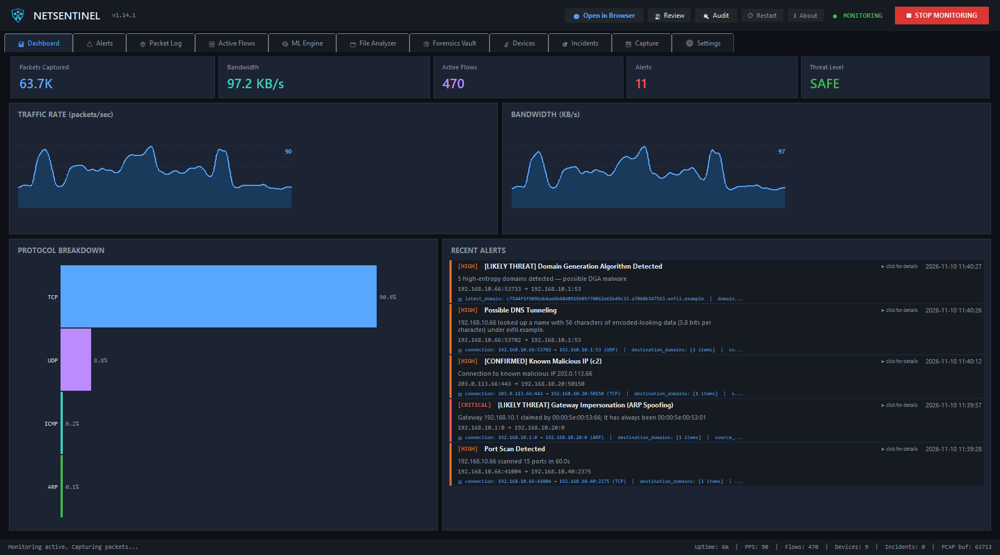
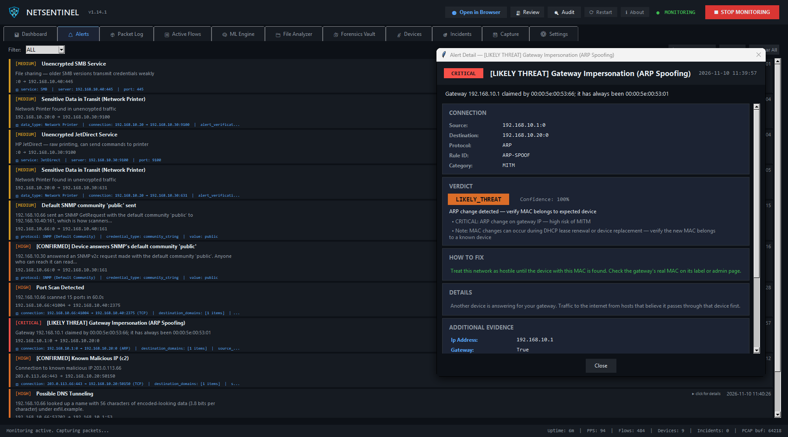

# NetSentinel

**Network monitor and intrusion detection for Windows, with machine-learning anomaly detection**

NetSentinel is a desktop network security application that monitors all traffic on your machine, detects anomalies using machine learning, and alerts you to suspicious activity in real time. It learns your network automatically — no configuration required.

**[⬇ Download NetSentinel.exe](https://github.com/jamesccupps/NetSentinel/releases/latest/download/NetSentinel.exe)** (Windows; live capture needs [Npcap](https://npcap.com/)) · [All releases](https://github.com/jamesccupps/NetSentinel/releases) · [Website](https://jamesccupps.github.io/NetSentinel/)

   [](https://github.com/jamesccupps/NetSentinel/actions/workflows/test.yml)



## Key Features

**Traffic Monitoring** — Full packet capture with live bandwidth charts, protocol breakdown, bidirectional flow tracking, and process identification.

**TLS Inspection** — Reads the plaintext ClientHello to recover the destination
hostname (SNI) and a JA3/JA4 client fingerprint from *encrypted* connections. The SNI
works even when the host uses DNS-over-HTTPS, because it comes from the handshake
rather than a DNS query. JA4 identifies the client software, so malware using its own
TLS stack stands out even when everything it sends is encrypted.

**Machine Learning** — Isolation Forest anomaly detection trained on your traffic baseline, with Welford's online statistics for O(1) incremental learning.

**Beaconing Detection** — Scores how scheduled a destination's traffic is using quartile skew, median absolute deviation and payload-size consistency. Survives the jitter every C2 framework enables by default, which a coefficient-of-variation test does not.

**Intrusion Detection** — Rule-based detectors: port scans, brute force, SYN/ICMP floods, suspicious DNS and DNS tunneling, data exfiltration, threat intelligence feeds, and more. Since v1.9.0 they also run on the monitoring PC's own traffic, which they used to skip.

**LAN threats** — ARP spoofing (with the gateway's MAC pinned), rogue DHCP and IPv6 router advertisements, LLMNR/NBT-NS/mDNS poisoning, lateral movement over SMB, RDP, WinRM and RPC, uploads far above a host's baseline, new devices with their vendor, cryptocurrency mining, and self-signed or expired certificates.

**DNS Response Analysis** — Reads the answer section, not just the query. Catches domain-generation-algorithm bursts from the pattern of failed lookups, and fast-flux hosting from address churn against a short TTL. Calibrated against the things that legitimately produce these signals: Chrome's startup hijack probe, Windows search-suffix expansion, and CDN TTLs.

**Network Forensics** — Scans for plaintext credentials (50+ protocol patterns), insecure services, sensitive data in transit. Findings go to an encrypted vault; by default only **masked** values are stored. See [Credential storage](#credential-storage) before enabling raw storage.

**Passive Device Learning** — Automatically discovers and classifies every device on your local network (gateway, workstation, IoT, printer, camera, server) from ARP, DHCP, mDNS, and traffic patterns alone. Remote internet hosts are not treated as devices.

**Exposures** — What is set up unsafely, kept apart from what is happening: plaintext logins, unencrypted services, devices answering SNMP's default community, software with known exploited flaws, bad certificates. Each is one entry per device and issue, alerted on once and rated at most HIGH (CRITICAL is for signs of an attack); it alerts again only if it gets worse or comes back after you mark it fixed. Accept one you have decided to live with. In the **Exposures** tab and on the dashboard.

**Uploads judged by their own history** — Large uploads are tracked per program and destination, by day, for 30 days. A program's first large upload to a destination is reported; after that only a day past four times its biggest. The alert names the program, and verification checks its signature (a signed general-purpose tool such as curl or PowerShell gets no credit for it). Mark an upload real and that pair is reported from the start again.

**Verdicts that teach** — **Real** and **False positive** on an alert acknowledge it and record what it was, in the dashboard and in the desktop app's alert window. A false positive stops that rule for that host or domain. **Rule record** shows, per rule, how many alerts were judged real or false, which is where detection needs work next. `test_detection_corpus.py` replays the attacks each rule exists for and the false alarms fixed so far; a change that quiets an attack fails it.

**Alert Correlation** — Groups related alerts into Incidents. Detects escalation chains (Reconnaissance → Attack, Threat Intel → Exfiltration) and presents them as a single narrative instead of 50 individual alerts.

**Baseline Whitelist** — During the initial learning period *only*, records every domain, IP, port, and periodic pattern as "normal for this network." Once that window closes, learning stops — so nothing an attacker does later can whitelist itself. No hardcoded whitelists.

**PCAP Export** — Ring buffer of raw packets with on-demand "save last 5 minutes" export and continuous recording with auto-rotation. Serious alerts automatically save the traffic that triggered them, narrowed to the hosts involved, so every CRITICAL finding opens in Wireshark. Those captures are kept for good, in their own folder.

**Browser dashboard** — NetSentinel serves a dashboard at `http://127.0.0.1:8737/` while it runs: live traffic and bandwidth charts, protocol and top-talker breakdowns, alerts with severity filters and evidence, devices, incidents, file scanning, the network audit, and what NetSentinel itself costs in CPU and memory. On this computer it can also start and stop monitoring, acknowledge alerts, record verdicts and mark exposures fixed or accepted; those controls need the token the page carries and are refused unless the dashboard is bound to localhost. **Open in Browser** in the desktop app opens it; `--headless` runs the same dashboard with no window, as a server.

**Review mode** — `--review DIR` or Settings → Review mode saves the traffic behind every alert. **Build review bundle** turns it into a small, redacted text bundle (summary, alerts, a line-per-packet digest per group) to upload to Claude chat and ask which alerts are real; no payloads, query strings, cookies, credentials or tokens are written. Import the verdicts back, and confirmed false positives are not raised again.

**Network audit** — on request only, and off until you turn it on: finds the devices on your own networks, checks 83 common ports at a limited rate, flags risky services with how to fix them, reads every TLS certificate, and shows what changed since the last audit. Gentle mode for building and industrial controllers. It never tries a password and only scans private networks this computer is on.

**Tray and restart** — closing the window keeps NetSentinel running in the system tray; the tray icon reopens it, opens the dashboard, starts or stops monitoring, restarts or quits. **Restart** applies settings that take effect at start, and resumes monitoring if it was running. `--monitor` starts monitoring as soon as it opens.

**GeoIP** — optional country and network operator for destinations, looked up on this machine. IP Geolocation by [DB-IP](https://db-ip.com), CC BY 4.0.

**Threat data** — the lists NetSentinel matches against are downloaded whole and checked on this machine; nothing about your traffic is sent out. The dashboard's **Threat data** page (and Settings → Threat data → **Threat data status**) shows each one: in use or not, when it last updated, how many entries, and why not when it isn't.

| Source | What it lists | Updated |
|---|---|---|
| abuse.ch Feodo Tracker, SSL Blacklist | Botnet C2 servers, hosts with malicious certificates | 6–12 h |
| abuse.ch URLhaus, ThreatFox, MalwareBazaar | Malware URLs; C2 addresses (with their port), domains and URLs; malware file hashes for file scans. **Need a free [abuse.ch Auth-Key](https://auth.abuse.ch/)** (Settings → Threat data), for not-for-profit use | 6 h; full hash list weekly |
| Emerging Threats, DShield, blocklist.de, CINS Army | Hosts seen attacking or compromised | 4–12 h |
| [Spamhaus DROP](https://www.spamhaus.org/blocklists/do-not-route-or-peer/) | Hijacked and criminal networks. Data: The Spamhaus Project | daily |
| Tor Project relay list | Running Tor relays, so a Tor connection is known for what it is | 6 h |
| WhoisDS | Newly registered domains | daily |
| [CISA KEV](https://www.cisa.gov/known-exploited-vulnerabilities-catalog) with NVD's version ranges | Vulnerabilities known to be exploited, matched against what devices here say they run | daily |
| Bundled with each release | Cloud and CDN ranges, mining pools, IDS rules | with releases |

**UniFi device names** — with a UniFi console (Network 9 or later), NetSentinel can read its client list so the Devices page and alerts say "Office 3D Printer" instead of an address. Make an API key in UniFi's Integrations settings and enter it, with the console's address, in Settings → UniFi. It is read only (the client list, nothing else), talks only to a console at a private address, pins the console's certificate on first use, and the names stay on this machine: review bundles leave them out.

**Your gateway's traffic log** — a UniFi gateway without a drive won't export its traffic log, but it can send it over syslog as it happens. Turn on Settings → UniFi traffic log over syslog (this PC's LAN address, a UDP port, and the gateway's address as the only sender allowed), then point the gateway's SIEM / remote syslog at this PC. NetSentinel keeps each day as JSON lines (30 days, 500 MB), never answers, and the **Device traffic** page shows what each device tried to reach and exports any day. UniFi sends the connections its firewall policies block (with the device, the domain and the policy), plus Wi-Fi, DHCP, admin and system events, but not the connections it allows: only NetFlow exports those. So block a device from the internet for a day, and the page shows what it needs. In UniFi 10.x the setting is CyberSecure → Traffic Logging → SIEM Server; tick Gateway in its contents to be able to add Firewall Default Policy. Windows Firewall must let the gateway's address in on that UDP port.

**Your gateway's threat detections** — with CyberSecure's IDS/IPS on, the same syslog carries each "Threat Detected" and "Threat Detected and Blocked" event, and NetSentinel raises each as a **UNIFI-IPS** alert: the signature and its number, the policy, UniFi's risk and what it did, and what NetSentinel adds. It says when the gateway's "incoming" is really the reply to something this PC sent first, and names NetSentinel's own alerts about the same address. A reputation-list hit (CINS Army and the like) on a shared Cloudflare, Akamai or Fastly address is checked as likely someone else's listing and rated LOW; an attack signature stays a likely threat. One alert per signature and pair of addresses every ten minutes.

**Known exploited vulnerabilities** — when a device on your network announces its software (a web server's `Server` header, an SSH, FTP or mail server's greeting), in traffic or to the network audit, its version is checked against CISA's list of vulnerabilities being exploited, using NVD's affected-version ranges. A match is a reason to check, not proof: a banner can hide its version, and Linux distributions patch old version numbers in place, which the alert points out. Internet servers are left alone. This product uses the NVD API but is not endorsed or certified by the NVD.

**Scan files for leaks** — drop any files, folders or zips on the dashboard's **Scan Files** page, or use **Scan Files / Zips** and **Scan Folder** in the desktop app's File Analyzer tab. Logs, configs, documents (Word, Excel, PDF), exports and packet captures all work. Archives (zip, 7z, tar, gzip and the like, nested), Windows event logs and Office macros are opened too. You get every IP address, domain, URL, email, MAC address, host name and UNC path in them, which files held each one, any the threat feeds know as bad, every password, key, token or card number that looks leaked, masked, with file and line, suspicious scripts such as encoded PowerShell, and files whose SHA-256 is on your known-bad lists. Anything can be put on an ignore list. Packet captures also get the full traffic analysis. Command line: `python -m src.batch_scan PATH... [--skip GLOB] [--json]`.

## Quick Start

### Prerequisites

- **Python 3.10+**
- **Npcap** (Windows packet capture driver) — download from [npcap.com](https://npcap.com/)
  - During install, check "Install in WinPcap API-compatible mode"
- **Administrator privileges** (required for packet capture)

### Install

The easy way: download `NetSentinel.exe` from the
[latest release](https://github.com/jamesccupps/NetSentinel/releases/latest), install
Npcap, and run it.

### Install with Scoop

With [Scoop](https://scoop.sh) (follow the link to install Scoop itself first):

```powershell
scoop bucket add jamesccupps https://github.com/jamesccupps/scoop-bucket
scoop install jamesccupps/netsentinel
```

Scoop installs the same `NetSentinel.exe` as the release, checked against its
SHA-256, and adds it to the Start menu. It does not install Npcap, which live
capture needs, and NetSentinel still asks to run as Administrator. Update with
`scoop update netsentinel`. The in-app **Update** button works too, but Scoop
doesn't see that and keeps listing the version it installed.

### From source

```bash
git clone https://github.com/jamesccupps/NetSentinel.git
cd NetSentinel
pip install -r requirements.txt
```

Or use the setup script:

```bash
setup.bat
```

### Run

```bash
python main.py                 # desktop interface
python main.py --headless      # no GUI, read-only HTTP API on 127.0.0.1:8737
python main.py --help
```

### Browser dashboard and headless mode

The desktop app serves a browser dashboard at `http://127.0.0.1:8737/` (or the
next free port), and **Open in Browser** in its top bar opens it. The detection
engine never needed a display, so it can also run as a sensor with no window at
all — on a Raspberry Pi hanging off a SPAN port, in a container, or on a server —
with `python main.py --headless` (or `NetSentinel.exe --headless`), and be read
in a browser or over HTTP.

The overview's traffic and bandwidth charts cover the last 15 minutes to 24
hours, kept by NetSentinel itself, so they are full the moment the page opens.
Point at either one for the time, the average and the peak. Alerts open to their
evidence as labeled fields with the advice first, devices sort by any column,
and the browser tab shows how many alerts are open.

| Endpoint | Returns |
|---|---|
| `GET /` | the dashboard |
| `GET /status.txt` | human-readable status summary |
| `GET /api/overview` | what the dashboard's overview shows |
| `GET /api/history?minutes=` | traffic rates for the charts, up to a day |
| `GET /api/sources` | every threat data source and whether it is in use |
| `GET /health` | liveness, for a supervisor or container probe |
| `GET /api/status` | capture, IDS, ML and alert counters |
| `GET /api/alerts` | recent alerts (`?limit=`, `?severity=`) |
| `GET /api/exposures` | standing conditions, one per device and issue |
| `GET /api/rules` | per rule: alerts, and how many were judged real or false |
| `GET /api/incidents` | correlated incidents |
| `GET /api/devices` | discovered devices on the local network |
| `GET /api/metrics` | Prometheus text exposition |
| `POST /api/scan/...` | upload files for the dashboard's file scan (needs the page's token) |

The API **binds to localhost by default** and cannot change configuration or
monitoring. It serves captured credentials, device inventory and alert history,
so `--host 0.0.0.0` logs a warning and should sit behind a firewall or an
authenticating reverse proxy. While bound to localhost it refuses requests for
any other host name, so a web page cannot read it through DNS rebinding, and
uploads need a token that only the dashboard page carries, so no other site can
drive them. `--no-api` runs with no listener and no dashboard.

Or build a standalone executable:

```bash
build_exe.bat
```

### First Launch

1. Click **START MONITORING** — NetSentinel begins capturing and learning
2. The ML engine enters **baseline learning mode** (2 hours by default)
3. During learning, it records what's normal for your specific network
4. After learning completes, anomaly detection activates automatically
5. Alerts appear in real-time in the **Alerts** tab
6. The **Devices** tab shows all discovered devices and their classifications
7. The **Incidents** tab groups related alerts into correlated events

### Updates

NetSentinel asks GitHub for a newer release at start and once a day, sending
nothing but its version (turn it off under Settings → Updates). When one is out,
an **Update** button appears in the status bar. Clicking it shows the release
notes, and **Install and restart** does the rest:
1. It checks the release's signature (`NetSentinel.exe.sig`, Ed25519, made by
   the release workflow) against a key built into NetSentinel.
2. It downloads the exe and checks its SHA-256 against the signed one.
3. It swaps the exe, keeping the old one as `NetSentinel.exe.old` until the
   next start, and restarts. Monitoring resumes if it was running.

Nothing is installed without that click, nor anything that fails a check. Run
from source, NetSentinel only says a new version is out.

## Screenshots




## Architecture

```
Scapy Capture → Queue → Worker Thread → IDS Engine       → Alert Verifier → Alert Manager → GUI
                                       → IOC Scanner      ↗                 → Correlator
                                       → Forensics Engine                   → Desktop Notify
                                       → Device Learner
                                       → Baseline Whitelist
                           ↓
                     ML Analysis Loop → Anomaly Detector → (alerts via same gateway)
                           ↓
                     PCAP Ring Buffer → On-demand export
```

All detection engines feed through a single verified alert gateway that enriches, verifies, and deduplicates before the user sees anything.

## Configuration

Configuration lives in `~/.netsentinel/config.json` (created on first run with defaults). Key settings:

| Section | Setting | Default | Description |
|---------|---------|---------|-------------|
| `capture` | `max_pps` | 2000 | Max packets/sec handed to the analysis pipeline |
| `capture` | `pcap_buffer_packets` | 150000 | Ring buffer size for PCAP export |
| `ml` | `baseline_learning_hours` | 2 | Hours of initial baseline learning |
| `ml` | `contamination` | 0.25 | Isolation Forest contamination (shapes the model) |
| `ml` | `alert_threshold` | 0.25 | Combined anomaly score (0-1) required to alert |
| `ml` | `feature_history_days` | 90 | Days of feature vectors to retain |
| `ids` | `port_scan_threshold` | 15 | Ports in window to trigger scan alert |
| `ids` | `brute_force_threshold` | 10 | Failed connections to trigger brute force alert |
| `ids` | `beaconing_score_threshold` | 0.75 | Beacon score (0-1) required to report a destination |
| `ids` | `dns_nxdomain_threshold` | 15 | Failed lookups in 60s before a DGA burst is reported |
| `ids` | `dns_flux_address_threshold` | 8 | Addresses for one name before fast-flux is reported |
| `ids` | `blocked_ja3` | `[]` | JA3 client fingerprints to alert on |
| `ids` | `blocked_ja4` | `[]` | JA4 client fingerprints to alert on |
| `alerts` | `severity_filter` | LOW | Minimum severity to display |
| `alerts` | `cooldown_sec` | 30 | Min seconds between duplicate alerts |
| `forensics` | `save_credentials` | true | Persist findings to the encrypted vault |
| `forensics` | `store_raw_credentials` | false | Keep full plaintext secrets (opt-in) |
| `forensics` | `vault_passphrase` | `""` | Set for real vault confidentiality (scrypt) |
| `forensics` | `retention_days` | 365 | Findings older than this are pruned at startup |
| `capture` | `pcap_max_files` | 20 | Recordings kept before the oldest are pruned |
| `capture` | `pcap_on_alert` | true | Save the traffic behind serious alerts |
| `capture` | `pcap_on_alert_severity` | CRITICAL | Minimum severity that triggers a save |
| `capture` | `pcap_on_alert_seconds` | 60 | Seconds of buffered traffic to save |
| `capture` | `alert_min_free_mb` | 1024 | Alert captures are never deleted; below this much free disk, new ones are skipped |
| `threat_intel` | `abuse_ch_auth_key` | `""` | Free key from auth.abuse.ch: URLhaus, ThreatFox, MalwareBazaar |
| `vulns` | `enabled` | true | Check devices' software against known exploited vulnerabilities |

An old default that a saved `config.json` kept is replaced once, at start, when a
later version changed it: the capture filter that hid HTTPS until September 2026,
and the 500 packets a second analysis cap. A value you set yourself stays.

Every key in `config.json` is read by the code. If you set something, it takes effect.

You can optionally pre-configure known devices to reduce false positives, but this is entirely optional — NetSentinel learns devices automatically from traffic:

```json
{
  "known_devices": {
    "devices": [
      {"name": "NAS", "ip": "192.168.1.50", "type": "server"},
      {"name": "Printer", "ip": "192.168.1.200", "type": "printer"}
    ]
  }
}
```

## Data Storage

All runtime data is stored locally in `~/.netsentinel/`:

| Path | Contents |
|------|----------|
| `config.json` | User configuration |
| `data/alerts.json` | Alert history |
| `data/baseline.json` | ML baseline (Welford online statistics) |
| `data/baseline_whitelist.json` | Learned normal domains/IPs/patterns |
| `data/learned_devices.json` | Passive device inventory |
| `data/incidents.json` | Correlated incident history |
| `data/exposures.json` | Exposures, with their state (open, accepted, fixed) |
| `data/upload_history.json` | MB uploaded per program and destination per day, 30 days |
| `data/feature_history/` | Daily CSV feature vectors for ML training |
| `models/` | Empty: the model is retrained from the feature history at each start, never saved |
| `captures/` | Exported PCAP files and recordings |
| `captures/alerts/` | The traffic behind each alert, kept for good |
| `review/snippets/` | The same, in review mode, kept for good |
| `review/capture/` | Review mode's rolling full capture (24 hours, 2 GB) |
| `logs/` | Application logs |

## Credential storage

NetSentinel extracts credentials from unencrypted protocols. Understand what it
keeps before you run it on a network you care about.

- The vault (`~/.netsentinel/data/forensics/credentials.enc`) uses **Fernet —
  AES-128-CBC + HMAC-SHA256**. Not AES-256.
- **By default the key is derived from hostname + username.** That ties the file
  to one machine but is *not secret*: anyone holding the file can usually
  reproduce it. It protects against casual inspection, nothing more.
- **By default only masked values are stored.** Set
  `forensics.store_raw_credentials` to `true` to retain full plaintext secrets.
- For genuine confidentiality, set `forensics.vault_passphrase`. Key derivation
  then uses scrypt over a random salt, and the vault cannot be opened without it.
- Set `forensics.enabled` to `false` to turn credential scanning off entirely.

Data files are created `0700`/`0600` where the platform supports it. See
[SECURITY.md](SECURITY.md).

## Uninstalling

NetSentinel has no installer. It adds no service, scheduled task, startup entry
or registry key, and it never changes the firewall. To remove it:

1. Quit it from the tray icon's **Quit**: closing the window only hides it
   there. The exe runs as two processes; check Task Manager that neither is
   left.
2. Delete `NetSentinel.exe`, with any `NetSentinel.exe.old` or
   `NetSentinel.update.exe` an interrupted update left beside it. Installed
   with Scoop, run `scoop uninstall netsentinel` instead: it removes the exe
   and its Start menu shortcut, and leaves your data for the next step.
3. Delete `~/.netsentinel` (`%USERPROFILE%\.netsentinel` on Windows). It holds
   your settings, alert history, device list, captures, credential vault and
   logs; copy out `captures/alerts/` first if you want the traffic behind past
   alerts. If you ran review mode with `--review DIR`, delete that folder too.
4. The exe unpacks itself into `%TEMP%\_MEI…` each time it starts and removes
   that folder when it exits, so a crash or a forced stop leaves one behind.
   NetSentinel's hold a `src` folder (other programs built the same way use the
   same name), and they are safe to delete while it isn't running.
5. If you ran it listening off localhost (the syslog receiver, or `--host`),
   Windows may have added inbound firewall rules for it when it asked whether
   to allow it. They are under Windows Defender Firewall → Advanced settings →
   Inbound Rules, listed by the exe's file name.
6. Npcap has its own uninstaller in Settings → Apps. Wireshark and Nmap use it
   too, so keep it if you use either.

Run from source, delete the clone and the `NetSentinel.bat` that `setup.bat`
put on the desktop. If you installed `requirements.txt` outside a virtual
environment, `pip uninstall -r requirements.txt` removes those packages; skip
any another program needs.

## Known scope limits

Worth knowing before you rely on a detector:

- **`capture.max_pps` caps processing at 2000 packets per second.** Past it, the
  middle of a download is counted to its flow but not inspected ("Bulk data not
  inspected" on the dashboard), and everything else gets up to twice the cap before
  any is dropped. Raise it if you need full visibility on a busy link; the pipeline
  measures ~72 µs/packet, so 2000 pps is roughly 15% of one core.
- **JA4 fingerprints are not matched against a list.** FoxIO's JA4DB went behind an
  enterprise sign-up in 2026, with terms that forbid copying it; `ids.blocked_ja4`
  takes your own.
- **A desktop sees mostly its own traffic.** Lateral movement, rogue DHCP and the
  like between other machines are only visible with a mirror (SPAN) port.
- **TLS payload stays opaque.** NetSentinel reads the handshake, not the content.
  It can tell you *who* a host talked to and *what software* did the talking, not
  what was said.
- **`DATA-EXFIL` only counts traffic leaving the local network.** Purely internal
  LAN-to-LAN transfers (a NAS backup, for example) are deliberately out of scope.
- **Process attribution needs privileges.** Without them `psutil` cannot map
  sockets to other users' processes and alerts show `process: Unknown`.

## Testing

```bash
# Everything (about 2,500 tests: tests/ and netmon_tests/; no network access)
python -m unittest discover -s . -p "test_*.py"

# Review mode, live detection, LAN threats, file scans, the network audit
python -m unittest tests/test_review.py tests/test_live_detection.py tests/test_lan_threats.py tests/test_scan_secrets.py tests/test_audit.py -v

# Regression tests for the v1.5.0 audit fixes
python -m unittest tests/test_regressions.py -v

# Coverage for modules the original suite never reached
python -m unittest tests/test_coverage.py -v

# TLS ClientHello parsing, fingerprinting and hostile input
python -m unittest tests/test_tls.py -v

# Presentation logic (formatting, thresholds, filtering)
python -m unittest tests/test_presentation.py -v

# Beaconing detection, including the jitter calibration
python -m unittest tests/test_beaconing.py -v

# DNS response analysis and its false-positive calibration
python -m unittest tests/test_dns_analysis.py -v

# Headless mode and the HTTP API
python -m unittest tests/test_headless.py -v

# End-to-end integration checks (real code paths, no capture required)
python tools/integration_check.py

# Generate live attack traffic against a running instance (separate terminal)
python tools/simulate_attacks.py --list
```

CI runs the suite on Python 3.10, 3.11 and 3.12 — see
[`.github/workflows/test.yml`](.github/workflows/test.yml).

## Project Structure

```
NetSentinel/
├── main.py                   # Entry point, splash screen, admin elevation
├── src/
│   ├── app.py                # Application orchestrator
│   ├── capture.py            # Packet capture engine (Scapy + queue architecture)
│   ├── ids_engine.py         # 12-rule intrusion detection system
│   ├── ml_engine.py          # Isolation Forest + Welford baseline + beaconing
│   ├── forensics.py          # Credential scanning, protocol analysis (50+ patterns)
│   ├── forensics_db.py       # Encrypted credential vault (Fernet/AES-128)
│   ├── alert_verify.py       # Multi-factor alert verification and scoring
│   ├── alerts.py             # Alert storage, filtering, notification batching
│   ├── alert_correlator.py   # Groups alerts into incidents with escalation detection
│   ├── exposures.py          # Standing conditions, one entry per device and issue
│   ├── upload_history.py     # Uploads per program and destination per day
│   ├── device_learner.py     # Passive device discovery and classification
│   ├── baseline_whitelist.py # Learns normal traffic patterns automatically
│   ├── pcap_writer.py        # Ring buffer + PCAP export + continuous recording
│   ├── threat_intel.py       # Threat feed downloader and matcher
│   ├── vulns.py              # CISA KEV + NVD ranges, matched to device banners
│   ├── data_sources.py       # Every threat data source and its state
│   ├── ioc_scanner.py        # Indicators of compromise (process, port, behavior)
│   ├── net_detect.py         # Network environment auto-detection
│   ├── process_verify.py     # Deep process investigation (signatures, hashes)
│   ├── pcap_analyzer.py      # Offline PCAP file analysis
│   ├── feature_store.py      # Persistent ML feature vector storage
│   ├── tls_inspect.py        # ClientHello parsing: SNI, JA3/JA4, QUIC detection
│   ├── beaconing.py          # Jitter-tolerant periodicity scoring
│   ├── dns_analysis.py       # NXDOMAIN bursts, fast-flux, DGA heuristics
│   ├── headless.py           # Read-only HTTP API for GUI-less operation
│   ├── presentation.py       # Pure formatting/threshold/filter logic (no tkinter)
│   ├── ipcache.py            # Cached IP address classification
│   ├── config.py             # Configuration management
│   └── gui.py                # tkinter dashboard (11 tabs)
├── tests/                    # Unit and regression tests (test_*.py) and their shared support
├── netmon_tests/             # Tests for netmon, the site-wide sensor
├── docs/                     # AUDIT.md (the v1.5.0 audit) and REVIEW.md (the second-pass review)
├── tools/
│   ├── integration_check.py  # End-to-end checks against real code paths
│   └── simulate_attacks.py   # Traffic generator for manual verification
├── rules/                    # Detection rules (JSON) — loaded at startup
├── assets/                   # Icons
├── setup.bat                 # Windows one-click setup
├── build_exe.bat             # PyInstaller build script
└── requirements.txt
```

## Security

Please report vulnerabilities privately — see [SECURITY.md](SECURITY.md).
NetSentinel runs with Administrator/root privileges and stores captured
credentials, so treat it as privileged software.

`docs/AUDIT.md` documents a full review of the codebase and the fixes applied in
v1.5.0.

## License

MIT — see [LICENSE](LICENSE).
